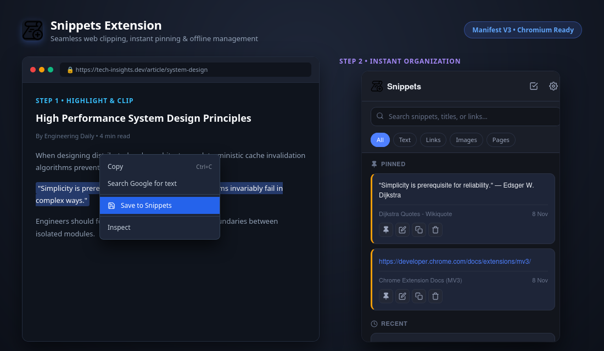
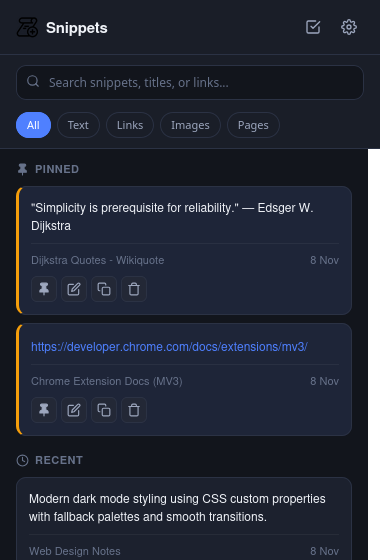
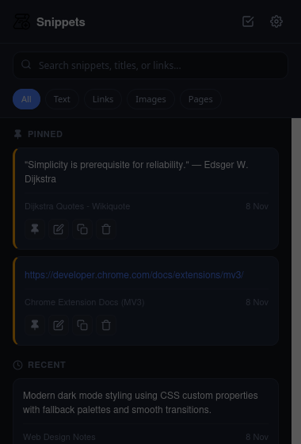

<div align="center">


# Snippets

**A fast, private, and lightweight web clipper & snippet manager for Chromium browsers.**

[](https://developer.chrome.com/docs/extensions/mv3/intro/)
[](https://developer.mozilla.org/en-US/docs/Web/JavaScript)
[](LICENSE)
[](https://github.com/rahilanw4r/snipptes)

*Capture quotes, code blocks, reference links, and images across the web with a single right-click — organized, searchable, and always at your fingertips.*

<br/>



</div>

---

## 📑 Table of Contents

- [Overview](#-overview)
- [How to Use the Extension](#-how-to-use-the-extension)
  - [1. Clipping Content from Any Webpage](#1-clipping-content-from-any-webpage)
  - [2. Organizing & Pinning Snippets](#2-organizing--pinning-snippets)
  - [3. Searching & Filtering](#3-searching--filtering)
  - [4. In-Place Editing](#4-in-place-editing)
  - [5. Batch Selection & Bulk Cleanup](#5-batch-selection--bulk-cleanup)
  - [6. Exporting & Restoring Backups](#6-exporting--restoring-backups)
- [Features](#-features)
- [Installation Guide](#-installation-guide)
- [Keyboard Shortcuts](#-keyboard-shortcuts)
- [Data Privacy & Storage](#-data-privacy--storage)
- [Project Architecture](#-project-architecture)
- [License](#-license)

---

## 💡 Overview

**Snippets** is designed to eliminate context switching while browsing, researching, or writing code. Instead of copying text back and forth between temporary tabs, chat windows, or heavy desktop note apps, Snippets lets you collect reference material directly from the browser context menu and access it instantly through an uncluttered popup.

Everything is stored in your local browser sandbox — no account registration, no remote servers, and zero telemetry.

---

## 📖 How to Use the Extension

### 1. Clipping Content from Any Webpage

You can save any content from any tab using the built-in browser context menu:

- **Save Text / Code**: Highlight any text on the page $\rightarrow$ Right-click $\rightarrow$ select **"Save selection to Snippets"**.
- **Save Links**: Right-click on any hyperlink $\rightarrow$ select **"Save link to Snippets"**.
- **Save Images**: Right-click on any picture or photo $\rightarrow$ select **"Save image to Snippets"**.
- **Save Entire Page**: Right-click on an empty part of the webpage $\rightarrow$ select **"Save page to Snippets"**.

> *When a snippet is clipped, the extension badge briefly flashes a blue checkmark (`✓`) in your toolbar to confirm the save without interrupting your reading.*

---

### 2. Organizing & Pinning Snippets

Click the **Snippets** icon in your browser toolbar to open your personal snippet tray:

<div align="center">
  
</div>

- **Pin High-Priority Items**: Click the **Pin** icon on any snippet card to promote it to the **Pinned** section at the top. Pinned snippets always remain visible above recent clips.
- **Unpin Anytime**: Clicking the pin icon again moves the snippet back into the chronological **Recent** list.
- **Drag & Drop Reordering**: Grab the 6-dot drag handle on the top-right of any card to drag and reorder cards within the section.
- **One-Click Copy**: Click the **Copy** icon to immediately copy the snippet's raw content to your system clipboard with a subtle toast notification.
- **Read More**: Long snippets are automatically clamped to 4 lines. Click **Read More** / **Read Less** to expand or collapse.

---

### 3. Searching & Filtering

- **Instant Search**: Type into the search input at the top to filter across snippet content, web page titles, and source URLs simultaneously in real time.
- **Category Pills**: Tap on the filter pills (`All`, `Text`, `Links`, `Images`, `Pages`) to narrow down items by content type.

---

### 4. In-Place Editing

Need to add a personal comment, clean up boilerplate, or update a snippet title?

<div align="center">
  
</div>

1. Click the **Edit** (pencil) icon on any card.
2. Update the **Title / Source** or edit the **Content** text area.
3. Click **Save Changes** (or press `Esc` / click the overlay background to cancel).

---

### 5. Batch Selection & Bulk Cleanup

When you want to clean up multiple outdated notes at once:

1. Click the **Multi-Select** checklist icon in the header.
2. Click any snippet cards you want to mark for deletion.
3. Click the red **Trash** button to delete all selected snippets at once, or click **Cancel** (`✕`) to exit selection mode.

---

### 6. Exporting & Restoring Backups

Your data is completely under your control and portable:

<div align="center">
  
</div>

- **Export JSON**: Click the **Settings** (gear) icon in the header $\rightarrow$ click **Export** to download a clean, dated JSON backup file (`snippets_backup_YYYY-MM-DD.json`).
- **Import JSON**: Click **Import** and select any backup JSON file. Snippets are merged smoothly with collision-free unique IDs.
- **Clear All Data**: Reset your local extension storage when starting a fresh workspace.

---

## ✨ Features

| Feature | Detail |
| :--- | :--- |
| **🚀 Instant Web Clipper** | Saves text selections, links, images, and full pages straight from the browser right-click menu. |
| **📌 Dual-Section Organization** | Distinct Pinned and Recent sections for clean visual hierarchy. |
| **✋ Smooth Drag & Drop** | Native HTML5 drag-and-drop reordering without flickering or external libraries. |
| **⚡ Instant Search Engine** | Sub-millisecond substring matching across bodies, source titles, and origin URLs. |
| **🏷️ Type Categorization** | Filter tabs for Text, Hyperlinks, Images, and Full Page bookmarks. |
| **📝 Inline Modal Editor** | Edit notes, format URLs, or rewrite titles with an accessible modal dialog. |
| **☑️ Multi-Selection Mode** | Easily select and batch-delete multiple items with confirmation prompts. |
| **📋 Clipboard Integration** | Fast copy-to-clipboard with fallback support and toast feedback. |
| **💾 JSON Backup & Migration** | One-click export and import for hassle-free data backups and migration. |
| **🌙 Abyss / Dark Theme** | High-contrast dark palette tailored for night-time browsing and developer workspaces. |
| **🛡️ 100% Private & Sandboxed** | Operates strictly via sandboxed `chrome.storage.local`. Zero network pings. |

---

## 🚀 Installation Guide

### Manual Unpacked Installation (All Chromium Browsers)

Supported on **Google Chrome**, **Brave**, **Microsoft Edge**, **Arc**, **Vivaldi**, and **Opera**.

1. **Clone or Download the Repository**:
   ```bash
   git clone https://github.com/rahilanw4r/snipptes.git
   ```
   *(or download as a `.zip` archive from GitHub and extract it)*.

2. **Open Extensions Manager**:
   - In Chrome / Brave: Navigate to `chrome://extensions/`
   - In Edge: Navigate to `edge://extensions/`

3. **Enable Developer Mode**:
   - Toggle the switch labeled **Developer mode** in the upper-right corner.

4. **Load Unpacked**:
   - Click the **Load unpacked** button in the top left.
   - Choose the `Snippets` project folder.

5. **Pin to Toolbar**:
   - Click the puzzle piece icon (Extensions) in your browser toolbar and pin **Snippets** for quick access.

---

## ⌨️ Keyboard Shortcuts

| Shortcut / Action | Function |
| :--- | :--- |
| `Esc` | Close any active modal dialog (Edit Modal or Settings Modal) or exit Multi-Select Mode |
| `Click Backdrop` | Click anywhere outside modal cards to immediately dismiss the modal |
| `Enter` in Search | Jump through filtered results |
| `Click Card` *(Selection Mode)* | Toggle selection checkbox for the clicked card |

---

## 🔒 Data Privacy & Storage

- **Zero External Requests**: The extension makes no network requests. There are no tracking scripts, analytics, or external CDNs.
- **Local Persistence**: All snippets are saved directly inside Chrome's sandboxed `chrome.storage.local` engine.
- **Portability**: Standard JSON backup format ensures you can extract or move your data whenever you like.

---

## 📁 Project Architecture

```text
Snippets/
├── background.js       # Manifest V3 service worker & context menu listener
├── manifest.json       # Extension configuration, permissions & metadata
├── popup.html          # Main popup UI markup with modal templates & filter tabs
├── popup.css           # Modern dark-mode styling, animations & layout
├── popup.js            # Core UI controller, drag & drop, search & backup logic
├── icons/              # Multi-resolution icons (16px, 32px, 48px, 128px)
│   ├── icon16.png
│   ├── icon32.png
│   ├── icon48.png
│   └── icon128.png
├── assets/             # Screenshots, previews & walkthrough media
│   ├── showcase.png
│   ├── extension-popup.png
│   ├── edit-modal.png
│   └── settings-modal.png
├── LICENSE             # MIT License
├── .gitignore          # Git exclusion rules
└── README.md           # Documentation
```

---

## 📄 License

Distributed under the [MIT License](LICENSE). You are free to modify, distribute, and integrate this software into your personal or commercial workflows.

---

<div align="center">
  <sub>Built with care by <a href="https://github.com/rahilanw4r">Rahil Anwar</a></sub>
</div>
